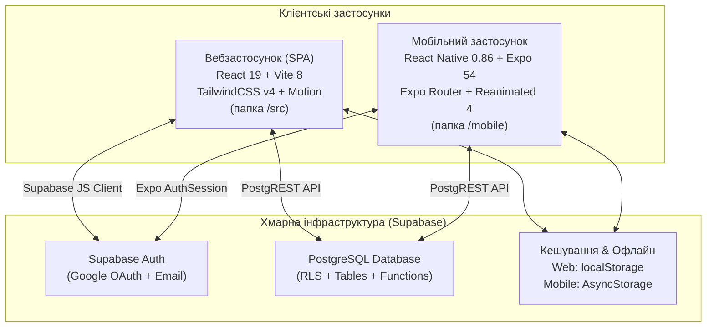

# FitLog — Карта структури проєкту (PROJECT_MAP.md)

Цей документ містить повний архітектурний огляд та детальний довідник усіх важливих файлів проєкту **FitLog**: вебверсії (React 19 + Vite), мобільного застосунку (React Native + Expo Router), бекенду (Supabase PostgreSQL) та тестових скриптів.

---

## Зміст

1. [Огляд архітектури та технологічного стеку](#огляд-архітектури-та-технологічного-стеку)
2. [Порівняння реалізацій: Веб (Vite) vs Мобільний застосунок (Expo)](#порівняння-реалізацій-веб-vite-vs-мобільний-застосунок-expo)
3. [Навігація та Navbar](#1-навігація-та-navbar)
4. [Тренування та шаблони](#2-тренування-та-шаблони)
5. [Вправи, підходи, суперсети та 1RM](#3-вправи-підходи-суперсети-та-1rm)
6. [Свайпи, жести й анімації](#4-свайпи-жести-й-анімації)
7. [Аналітика та календар](#5-аналітика-та-календар)
8. [Профіль, ролі та підопічні](#6-профіль-ролі-та-підопічні)
9. [Авторизація Google OAuth](#7-авторизація-google-oauth)
10. [Supabase, API та робота з базою даних](#8-supabase-api-та-робота-з-базою-даних)
11. [Стилі, теми та UI-компоненти](#9-стилі-теми-та-ui-компоненти)
12. [Конфігурація та збірка](#10-конфігурація-та-збірка)
13. [Тестові та перевірочні скрипти (Scripts)](#11-тестові-та-перевірочні-скрипти-scripts)

---

## Огляд архітектури та технологічного стеку

---

## Порівняння реалізацій: Веб (Vite) vs Мобільний застосунок (Expo)

| Критерій | Вебверсія (`/src`) | Мобільна версія (`/mobile`) |
| :--- | :--- | :--- |
| **Фреймворк** | React 19, Vite 8 | React Native 0.86, Expo 54, Expo Router |
| **Стилізація** | Tailwind CSS v4, CSS Variables, Glassmorphism | `StyleSheet.create`, токени `theme.ts`, `expo-glass-effect` (Liquid Glass) |
| **Навігація** | SPA перемикання станів у `App.tsx` (`currentTab`, `workoutViewMode`) | Файловий Expo Router (`app/`) + горизонтальний пейджер `InstagramTabPager` |
| **Жести та свайпи** | Web Touch/Pointer Events (`useSwipeGesture.ts`, `useEdgeSwipeBack.ts`) | Нативні `react-native-gesture-handler` та `react-native-reanimated 4` |
| **Офлайн-сховище** | `window.localStorage` | `@react-native-async-storage/async-storage` |
| **Тактильний відгук** | Web Audio API (звук таймера) | `expo-haptics` (успіх, вибір, видалення) + Web Vibration fallback |
| **Google OAuth** | Редирект/Popup через Supabase JS | `expo-auth-session`, `expo-web-browser`, deep link схема `fitlog://` |
| **Єдина бізнес-логіка** | Формула Бжицького (1RM), Mifflin-St Jeor (КБЖВ), схема Supabase RLS | Спільні математичні алгоритми, моделі типів та SQL-структура таблиць |

---

## 1. Навігація та Navbar

### `src/components/Navbar.tsx`
- **Призначення**: Головний навігаційний бар вебверсії (адаптивний десктопний хедер та мобільний плаваючий док).
- **Основні функції**:
  - Перемикання вкладок: Тренування (`editor`), Аналітика (`analytics`), Каталог вправ (`catalog`), Історія (`history`), Підопічні (`trainees`), Профіль (`profile`).
  - Відображення активного тренування з пульсуючим індикатором.
  - Кнопка швидкого створення тренування `+`.
  - Перемикач теми (світла/темна) та мови (UA/EN).
  - Аватар поточного користувача з бейджем ролі (тренер, атлет, адмін).
- **Залежності**:
  - Імпортує: `src/context/AuthContext.tsx`, `src/context/ThemeContext.tsx`, `src/context/LanguageContext.tsx`, `src/components/UserAvatar.tsx`.
  - Використовується в: `src/App.tsx`.
- **Що змінювати тут**:
  - Додати новий пункт меню або вкладку для вебу.
  - Змінити дизайн мобільного док-бара (скляний ефект, висота, відступи).
  - Змінити логіку показу пунктів для тренера/атлета.

### `src/App.tsx`
- **Призначення**: Кореневий компонент та менеджер станів вебверсії FitLog.
- **Основні функції**:
  - Управління активною вкладкою (`currentTab`) та режимом тренування (`list` або `editor`).
  - Відкриття модальних вікон створення тренування (`CreateWorkoutModal`) та авторизації (`GoogleAuthModal`).
  - Обробка повернення з редактора тренування на попередню вкладку (`returnToTab`).
  - Збереження контексту вибраного підопічного при редагуванні тренувань тренером.
  - Обгортка всього додатку в провайдери `AuthProvider`, `ThemeProvider`, `LanguageProvider`.
- **Залежності**:
  - Імпортує: всі основні view-компоненти з `src/components/*`, контексти з `src/context/*`, сервіси `StorageService`, `TemplateService`.
  - Використовується в: `src/main.tsx`.
- **Що змінювати тут**:
  - Змінити глобальні маршрути або поведінку перемикання екранів у вебі.
  - Додати глобальні провайдери або модальні вікна.
  - Змінити логіку створення нового тренування з хедера.

### `mobile/src/app/_layout.tsx`
- **Призначення**: Кореневий файл маршрутизації Expo Router для мобільного застосунку.
- **Основні функції**:
  - Ініціалізація та конфігурація теми навігації (`OceanNavigationDarkTheme`, `OceanNavigationLightTheme`).
  - Автоматичний редирект неавторизованих користувачів на `/(auth)/login`, а авторизованих — на `/(tabs)`.
  - Завершення OAuth-сесій через `WebBrowser.maybeCompleteAuthSession()`.
  - Оголошення стеку навігації: `(tabs)`, `(auth)`, `workout/[id]`, `exercise/[id]`, `exercise/edit`, `trainees`.
  - Обгортка застосунку в глобальні провайдери: `GestureHandlerRootView`, `SafeAreaProvider`, `AuthProvider`, `AppThemeProvider`, `SwipeUndoProvider`, `CreateWorkoutProvider`, `ScrollTabBarProvider`.
- **Залежності**:
  - Імпортує: `mobile/src/context/*`, `mobile/src/services/authService.ts`.
  - Використовується в: системний вхід Expo Router.
- **Що змінювати тут**:
  - Додати новий глобальний екран у стек (наприклад, окремі налаштування або модалку).
  - Налаштувати параметри анімацій переходів між екранами.
  - Змінити перевірку авторизації та стартові екрани.

### `mobile/src/app/(tabs)/_layout.tsx`
- **Призначення**: Контролер вкладок мобільного застосунку.
- **Основні функції**:
  - Підключає та рендерить компонент `InstagramTabPager` для головних вкладок.
  - Відстежує поточний сегмент маршруту (`useSegments`).
  - Обробляє вкладений екран `calendar`, огортаючи його в `ScreenGestureWrapper` для підтримки жесту "назад".
- **Залежності**:
  - Імпортує: `mobile/src/components/InstagramTabPager.tsx`, `mobile/src/components/ScreenGestureWrapper.tsx`.
  - Використовується в: Expo Router при переході на `/(tabs)`.
- **Що змінювати тут**:
  - Змінити поведінку відкриття вкладених табів або жесту "назад" для вкладок.

### `mobile/src/app/(tabs)/index.tsx`, `analytics.tsx`, `exercises.tsx`, `profile.tsx`, `calendar.tsx`
- **Призначення**: Точки входу маршрутів Expo Router для кожної з вкладок.
- **Основні функції**:
  - `index.tsx`: рендерить `WorkoutsScreen`.
  - `analytics.tsx`: рендерить `AnalyticsScreen`.
  - `exercises.tsx`: рендерить `ExercisesScreen`.
  - `profile.tsx`: рендерить `ProfileScreen`.
  - `calendar.tsx`: рендерить `CalendarScreen`.
- **Залежності**: Імпортують відповідні екрани з `mobile/src/screens/*`.
- **Що змінювати тут**: Підключення метаданих маршруту або зміна цільового екрана вкладки.

### `mobile/src/components/InstagramTabPager.tsx`
- **Призначення**: Instagram-подібний 1:1 горизонтальний свайп-пейджер між 4 основними вкладками.
- **Основні функції**:
  - Плавне перемикання свайпом між `WorkoutsScreen` (0), `AnalyticsScreen` (1), `ExercisesScreen` (2), `ProfileScreen` (3).
  - Слідкування за пальцем у реальному часі без затримок через `react-native-reanimated`.
  - Збереження активної вкладки в пам'яті, `AsyncStorage` та `localStorage` (ключ `@fitlog_active_tab`).
  - Захист від конфліктів жестів: ігнорує свайпи лівих 24pt (системний iOS back) та правих 25% екрана (свайп карток тренувань).
  - Автоматичне закриття відкритих свайп-карток через `swipeCardManager.closeAll()` на початку свайпу екрана.
  - Рендерить плаваючий `LiquidGlassTabBar`.
- **Залежності**:
  - Імпортує: `mobile/src/screens/*`, `mobile/src/components/LiquidGlassTabBar.tsx`, `mobile/src/services/swipeCardManager.ts`.
  - Використовується в: `mobile/src/app/(tabs)/_layout.tsx`.
- **Що змінювати тут**:
  - Змінити чутливість або швидкість свайпу між вкладками (`SWIPE_DIST_THRESHOLD`, `VELOCITY_THRESHOLD`).
  - Додати або видалити вкладку з горизонтального пейджера.
  - Налаштувати логіку відновлення збереженої активної вкладки.

### `mobile/src/components/LiquidGlassTabBar.tsx`
- **Призначення**: Плаваючий нижній таб-бар мобільного застосунку з ефектом Liquid Glass.
- **Основні функції**:
  - Рендерить 4 кнопки вкладок: Тренування, Аналітика, Вправи, Профіль.
  - Центральна кругла синя кнопка `+` для виклику модалки створення тренування (`openCreateModal`).
  - Індикатор активного тренування (помаранчева крапка на кнопці "Тренування", якщо є статус `in_progress`).
  - Використовує нативне розмиття скла iOS через `expo-glass-effect` або напівпрозорий фолбек.
  - Анімоване приховування/поява при скролі через спільне значення `translateY` з `ScrollTabBarContext`.
- **Залежності**:
  - Імпортує: `mobile/src/context/ThemeContext.tsx`, `mobile/src/context/ScrollTabBarContext.tsx`, `mobile/src/context/CreateWorkoutContext.tsx`, `mobile/src/services/workoutService.ts`.
  - Використовується в: `mobile/src/components/InstagramTabPager.tsx`.
- **Що змінювати тут**:
  - Змінити форму, іконки, кольори або розмір нижнього таб-бару.
  - Налаштувати зовнішній вигляд центральної кнопки `+`.
  - Змінити логіку індикації активного тренування.

### `mobile/src/components/Header.tsx`
- **Призначення**: Універсальний верхній навігаційний бар мобільного застосунку.
- **Основні функції**:
  - Підтримка скляного розмиття (Frosted Glass) та адаптації під тему.
  - Кнопка повернення назад з можливістю передачі кастомного `onBack`.
  - Відображення заголовка, підзаголовка та правого контенту (кнопки дій, іконка календаря).
  - Іконка статусу підопічних для тренерів (`showCoachStatus`, перехід до `/trainees`).
  - Кнопка виходу з акаунту на екрані профілю (`showLogout`).
- **Залежності**:
  - Імпортує: `mobile/src/context/ThemeContext.tsx`.
  - Використовується в: практично всіх екранах папки `mobile/src/screens/*`.
- **Що змінювати тут**:
  - Змінити вигляд верхнього бару (висоту, відступи SafeArea, розмиття).
  - Додати глобальні кнопки у хедер (пошук, сповіщення).

### `mobile/src/components/ScreenGestureWrapper.tsx`
- **Призначення**: Обгортка для екранів другого рівня для забезпечення плавного iOS back-свайпу.
- **Основні функції**:
  - Перехоплює свайп від лівого краю екрана (`touch.absoluteX < 32`) для повернення назад.
  - Тактильний відгук `Haptics.selectionAsync()` при активації жесту повернення.
- **Залежності**: Використовується в `mobile/src/app/(tabs)/_layout.tsx`, `mobile/src/screens/TraineesScreen.tsx`, `mobile/src/screens/CalendarScreen.tsx`.
- **Що змінювати тут**:
  - Збільшити або зменшити зону спрацювання edge-swipe.

### `mobile/src/context/ScrollTabBarContext.tsx`
- **Призначення**: Контекст координації приховування таб-бару при скролі.
- **Основні функції**:
  - Обчислює дельту скролу списків через `handleScroll(event)`.
  - Плавно опускає нижній таб-бар вниз при скролі списку донизу і повертає назад при скролі вгору.
- **Залежності**: Використовується в `mobile/src/screens/WorkoutsScreen.tsx`, `AnalyticsScreen.tsx`, `ProfileScreen.tsx`, `ExercisesScreen.tsx` та `LiquidGlassTabBar.tsx`.
- **Що змінювати тут**:
  - Змінити поріг чутливості скролу або вимкнути приховування таб-бару.

---

## 2. Тренування та шаблони

### `src/components/WorkoutListView.tsx`
- **Призначення**: Головний екран списку тренувань у вебверсії.
- **Основні функції**:
  - Фільтрація тренувань за вкладками: Всі, Завершені, В процесі.
  - Групування тренувань за місяцями та роками.
  - Пошук тренувань за назвою.
  - Відображення карток тренувань з підтримкою мобільних свайпів (`MobileSwipeableWorkoutCard`).
  - Швидке копіювання тренування та видалення з можливістю підтвердження.
- **Залежності**:
  - Імпортує: `src/components/MobileSwipeableWorkoutCard.tsx`, `src/services/storageService.ts`, `src/utils/date.ts`.
  - Використовується в: `src/App.tsx`.
- **Що змінювати тут**:
  - Додати нові критерії сортування чи фільтрації у вебі.
  - Змінити верстку карток тренувань на десктопі.

### `src/components/WorkoutEditor.tsx`
- **Призначення**: Повнофункціональний редактор тренувань вебверсії.
- **Основні функції**:
  - Редагування назви, дати, статусу та нотаток тренування.
  - Додавання вправ через селектор (`ExerciseSelectorModal`).
  - Управління підходами: тип підходу (розминка `W`, робочий `R`, дропсет `D`, заминка `C`), вага, повторення, RPE.
  - Автоматичний розрахунок 1RM для кожного підходу.
  - Об'єднання вправ у суперсети (групи A, B, C...).
  - Вбудований таймер відпочинку між підходами зі звуковим сигналом (`audio.ts`).
  - Збереження тренування як багаторазового шаблону.
  - Drag-and-drop або кнопки перевпорядкування вправ.
- **Залежності**:
  - Імпортує: `src/components/ExerciseSelectorModal.tsx`, `src/services/storageService.ts`, `src/services/templateService.ts`, `src/utils/workout.ts`, `src/utils/audio.ts`.
  - Використовується в: `src/App.tsx`.
- **Що змінювати тут**:
  - Змінити алгоритм збереження прогресу вправ у вебверсії.
  - Додати нові типи підходів або поля (наприклад, темп чи дистанція).
  - Змінити логіку таймера відпочинку.

### `src/components/CreateWorkoutModal.tsx`
- **Призначення**: Модальне вікно створення нового тренування у вебверсії.
- **Основні функції**:
  - Введення назви тренування (з дефолтним "Силове тренування").
  - Вибір дати тренування.
  - Вибір зі списку створених шаблонів для швидкого старту.
  - Управління шаблонами (видалення непотрібних).
- **Залежності**:
  - Імпортує: `src/services/templateService.ts`, `src/types/workout.ts`.
  - Використовується в: `src/App.tsx`.
- **Що змінювати тут**:
  - Змінити інтерфейс вибору шаблону у вебверсії.
  - Додати автоматичне підставлення дати/часу або програми тренувань.

### `src/components/WorkoutHistoryView.tsx`
- **Призначення**: Екран історії завершених тренувань у вебверсії.
- **Основні функції**:
  - Відображає виключно завершені тренування користувача.
  - Швидкий перегляд виконаних вправ, тоннажу та повторень.
  - Можливість повторити будь-яке тренування з історії в один клік.
- **Залежності**: `src/services/storageService.ts`, `src/utils/date.ts`, `src/utils/workout.ts`.
- **Що змінювати тут**: Формат відображення історії тренувань у вебверсії.

### `src/services/templateService.ts`
- **Призначення**: Сервіс управління шаблонами тренувань для вебверсії.
- **Основні функції**:
  - `getTemplates(userId)`: отримання списку збережених шаблонів з `localStorage`.
  - `saveTemplate(template)`: створення нового шаблону з поточного тренування.
  - `deleteTemplate(templateId)`: видалення шаблону.
  - `createWorkoutFromTemplate(...)`: генерація нового об'єкта `WorkoutPlan` на основі обраного шаблону.
- **Залежності**: `src/types/workout.ts`, `src/services/storageService.ts`.
- **Що змінювати тут**: Зміна структури збереження або генерації тренування з шаблону.

### `mobile/src/screens/WorkoutsScreen.tsx`
- **Призначення**: Головний екран списку тренувань у мобільному застосунку.
- **Основні функції**:
  - Відображення списку тренувань зі швидким скролом та фільтрами: "Всі", "Завершені", "В процесі".
  - Свайп-картки тренувань (`SwipeableActionCard`): свайп вліво — видалення, свайп вправо — дублювання тренування.
  - Pull-to-Refresh: оновлення тренувань з тактильним відгуком успіху `triggerRefreshSuccessHaptic()`.
  - Збереження активної вкладки `setSavedActiveTab('index')`.
  - Відкриття модалки створення нового тренування (`CreateWorkoutModal`).
  - Перехід до редактора тренування за кліком на картку (`/workout/[id]`).
- **Залежності**:
  - Імпортує: `mobile/src/services/workoutService.ts`, `mobile/src/components/SwipeableActionCard.tsx`, `mobile/src/components/CreateWorkoutModal.tsx`, `mobile/src/utils/haptics.ts`.
  - Використовується в: `mobile/src/components/InstagramTabPager.tsx`, `mobile/src/app/(tabs)/index.tsx`.
- **Що змінювати тут**:
  - Змінити дизайн мобільної картки тренування (бейджи, колір статусу, тоннаж).
  - Змінити поведінку pull-to-refresh на першій вкладці.

### `mobile/src/screens/WorkoutEditorScreen.tsx`
- **Призначення**: Повнофункціональний нативний редактор тренувань мобільного застосунку.
- **Основні функції**:
  - Редагування назви, дати, коментарів тренування.
  - Додавання вправ через селектор `ExerciseSelectorModal`.
  - Управління підходами: вага, повторення, RPE, статус завершення підходу (чекбокс).
  - Підтримка типів підходів (Розминка, Робочий, Дропсет, Заминка).
  - Зв'язування вправ у суперсети з колірними бейджами (`supersets.ts`).
  - Плаваючий або вбудований таймер відпочинку з тактильним відгуком та звуковим сигналом.
  - Збереження тренування як шаблону.
  - Завершення тренування зі зміною статусу на `completed`.
- **Залежності**:
  - Імпортує: `mobile/src/components/ExerciseSelectorModal.tsx`, `mobile/src/services/workoutService.ts`, `mobile/src/services/templateService.ts`, `mobile/src/utils/workout.ts`, `mobile/src/constants/supersets.ts`.
  - Використовується в: `mobile/src/app/workout/[id].tsx`.
- **Що змінювати тут**:
  - Змінити логіку додавання/видалення підходів у мобільному застосунку.
  - Налаштувати логіку таймера відпочинку між сетами.
  - Змінити інтерфейс редагування суперсетів.

### `mobile/src/components/CreateWorkoutModal.tsx`
- **Призначення**: Нативне модальне вікно створення нового тренування у мобільному застосунку.
- **Основні функції**:
  - Введення назви тренування.
  - Кастомний інтерактивний вибір дати (`DatePickerModal`).
  - Вибір та застосування шаблону тренування.
  - Видалення створених шаблонів.
- **Залежності**: `mobile/src/services/templateService.ts`, `mobile/src/components/DatePickerModal.tsx`.
- **Що змінювати тут**: Інтерфейс та поля створення тренування на мобільному.

### `mobile/src/context/CreateWorkoutContext.tsx`
- **Призначення**: Глобальний контекст для виклику модалки створення тренування.
- **Основні функції**:
  - Дозволяє викликати `openCreateModal()` з будь-якого компонента (зокрема з центральної кнопки `+` в `LiquidGlassTabBar`).
- **Залежності**: Використовується в `mobile/src/app/_layout.tsx`, `LiquidGlassTabBar.tsx`, `WorkoutsScreen.tsx`.
- **Що змінювати тут**: Зміна параметрів створення тренування через глобальний виклик.

### `mobile/src/services/workoutService.ts`
- **Призначення**: Головний сервіс роботи з тренуваннями для мобільного застосунку.
- **Основні функції**:
  - `getWorkouts(userId)`: завантаження тренувань з локального кешу `AsyncStorage` та фонова синхронізація з Supabase.
  - `saveWorkout(workout)`: збереження тренування одночасно в локальне сховище та відправка в Supabase.
  - `deleteWorkout(workoutId)`: видалення з локального кешу та видалення в базі даних Supabase.
  - `duplicateWorkout(workout)`: швидке клонування тренування на сьогоднішню дату.
- **Залежності**: `mobile/src/lib/supabase.ts`, `mobile/src/lib/storage.ts`, `mobile/src/types/workout.ts`.
- **Що змінювати тут**:
  - Логіка синхронізації тренувань з хмарою.
  - Виправлення конфліктів при роботі в офлайн-режимі.

---

## 3. Вправи, підходи, суперсети та 1RM

### `src/components/ExerciseCatalogView.tsx`
- **Призначення**: Каталог та бібліотека вправ у вебверсії.
- **Основні функції**:
  - Фільтрація за групами м'язів: груди, спина, ноги, плечі, біцепс, трицепс, кор тощо.
  - Пошук вправ за назвою.
  - Перегляд списку дефолтних та створених користувачем кастомних вправ.
  - Кнопки додавання нової вправи (`CreateExerciseModal`) та редагування (`EditExerciseModal`).
  - Перегляд історії вправи та графіка 1RM (`ExerciseHistoryModal`).
- **Залежності**:
  - Імпортує: `src/components/CreateExerciseModal.tsx`, `src/components/EditExerciseModal.tsx`, `src/components/ExerciseHistoryModal.tsx`, `src/services/storageService.ts`.
  - Використовується в: `src/App.tsx`.
- **Що змінювати тут**: Зовнішній вигляд каталогу вправ та фільтрів у вебі.

### `src/components/ExerciseSelectorModal.tsx`
- **Призначення**: Модальне вікно вибору вправи для додавання у тренування у вебверсії.
- **Основні функції**:
  - Пошук вправ у режимі реального часу.
  - Фільтрація за м'язовими групами.
  - Створення нової вправи "на льоту", якщо її немає в каталозі.
- **Залежності**: `src/services/storageService.ts`, `src/types/workout.ts`.
- **Що змінювати тут**: Логіка додавання вправ до тренування у вебі.

### `src/components/ExerciseHistoryModal.tsx`
- **Призначення**: Модальне вікно детальної статистики та історії вправи у вебі.
- **Основні функції**:
  - Графік розрахункового 1RM (одноповторного максимуму) за часом.
  - Повний журнал усіх підходів, ваги та повторень за всю історію тренувань.
  - Рекорди: максимальна вага, максимальний 1RM, максимальний тоннаж за підхід.
- **Залежності**: `src/services/storageService.ts`, `src/utils/workout.ts`, `src/utils/date.ts`.
- **Що змінювати тут**: Графік 1RM, візуалізація рекордів та списку минулих підходів у вебі.

### `src/data/defaultExercises.ts`
- **Призначення**: Базовий набір стандартних вправ за замовчуванням (укр/англ).
- **Основні функції**: Містить масив дефолтних вправ із закріпленими групами м'язів (жим лежачи, присідання, тяга, підтягування тощо).
- **Залежності**: Використовується сервісами `storageService.ts` та `exerciseService.ts`.
- **Що змінювати тут**: Додати нові стандартні вправи або змінити їхні українські назви.

### `src/utils/workout.ts` та `mobile/src/utils/workout.ts`
- **Призначення**: Утиліти математичних розрахунків тренувань (спільна логіка для вебу та мобільного).
- **Основні функції**:
  - `calculate1RM(weight, reps)`: розрахунок 1RM за класичною науковою формулою Бжицького: `weight / (1.0278 - 0.0278 * reps)`.
  - `calculateExerciseVolume(exercise)`: розрахунок сумарного тоннажу вправи (вага × повторення по всіх робочих підходах).
  - `calculateTotalVolume(workout)`: загальний тоннаж всього тренування.
- **Залежності**: Використовується у всіх компонентах редактора, історії, карток та аналітики.
- **Що змінювати тут**:
  - Змінити або доповнити формулу розрахунку 1RM (наприклад, формула Еплі для високих повторень).
  - Змінити логіку підрахунку тоннажу (врахування розминки тощо).

### `mobile/src/screens/ExercisesScreen.tsx`
- **Призначення**: Екран каталогу вправ у мобільному застосунку.
- **Основні функції**:
  - Горизонтальний скрол чіпсів груп м'язів з лічильниками кількості вправ.
  - Швидкий пошук за назвою вправи.
  - Pull-to-refresh списку вправ з вібровідгуком та фіксацією вкладки `setSavedActiveTab('exercises')`.
  - Відкриття детальної статистики `/exercise/[id]` або модалки створення нової вправи.
- **Залежності**:
  - Імпортує: `mobile/src/services/exerciseService.ts`, `mobile/src/utils/haptics.ts`, `mobile/src/components/SwipeableActionCard.tsx`.
  - Використовується в: `mobile/src/components/InstagramTabPager.tsx`, `mobile/src/app/(tabs)/exercises.tsx`.
- **Що змінювати тут**: Дизайн карток вправ, поведінка пошуку та фільтрації на мобільному.

### `mobile/src/screens/ExerciseDetailScreen.tsx`
- **Призначення**: Окремий екран детальної статистики та історії виконання вправи у мобільному застосунку.
- **Основні функції**:
  - Картка особистих рекордів (All-Time PR: максимальна вага, розрахунковий 1RM, рекордний обсяг).
  - Графік прогресу 1RM.
  - Повна хронологія підходів з кожного тренування з датами.
  - Кнопка швидкого редагування вправи (`/exercise/edit`).
  - Безпечне повернення назад з відновленням джерела переходу (`sourceTab`: вправи або аналітика).
- **Залежності**:
  - Імпортує: `mobile/src/services/exerciseService.ts`, `mobile/src/services/workoutService.ts`, `mobile/src/utils/workout.ts`.
  - Використовується в: `mobile/src/app/exercise/[id].tsx`.
- **Що змінювати тут**: Відображення графіків прогресу або блоку рекордів на мобільному.

### `mobile/src/screens/ExerciseEditScreen.tsx`
- **Призначення**: Екран створення або редагування вправи в мобільному застосунку.
- **Основні функції**:
  - Введення назви вправи та вибір цільової групи м'язів.
  - Збереження вправ у базі даних Supabase та локальному кеші.
  - Видалення кастомних вправ користувача.
- **Залежності**: `mobile/src/services/exerciseService.ts`, `mobile/src/app/exercise/edit.tsx`.
- **Що змінювати тут**: Поля та валідація при створенні вправи на мобільному.

### `mobile/src/components/ExerciseSelectorModal.tsx`
- **Призначення**: Модальне вікно / Bottom sheet для вибору вправи у редакторі тренування.
- **Основні функції**:
  - Пошук, швидкий вибір групи м'язів.
  - Додавання обраної вправи у поточне тренування.
- **Залежності**: `mobile/src/services/exerciseService.ts`.
- **Що змінювати тут**: Інтерфейс вибору вправи під час тренування.

### `mobile/src/constants/supersets.ts`
- **Призначення**: Константи та колірна палітра для суперсетів у мобільному застосунку.
- **Основні функції**:
  - `SUPERSET_COLORS`: масив градієнтів та відтінків для позначення суперсетів A, B, C, D...
  - `getSupersetColor(groupIndex)`: функція отримання акцентного кольору для групи суперсету.
- **Залежності**: Використовується в `mobile/src/screens/WorkoutEditorScreen.tsx`.
- **Що змінювати тут**: Кольори та стиль бейджів суперсетів.

---

## 4. Свайпи, жести й анімації

### `mobile/src/components/SwipeableActionCard.tsx`
- **Призначення**: Універсальна картка зі свайп-діями для мобільного застосунку (на React Native Reanimated 4 + Gesture Handler).
- **Основні функції**:
  - Свайп вліво: відкриття кнопки видалення (червона зона) або автоматичне швидке видалення при повному свайпі.
  - Свайп вправо: дія копіювання / дублювання тренування (синя зона).
  - Підтримка тактильного вібровідгуку `Haptics.impactAsync(Medium)` при перетині порогу дії.
  - Інтеграція з `swipeCardManager`: при відкритті однієї картки всі інші автоматично закриваються.
- **Залежності**:
  - Імпортує: `react-native-reanimated`, `react-native-gesture-handler`, `expo-haptics`, `mobile/src/services/swipeCardManager.ts`.
  - Використовується в: `WorkoutsScreen.tsx`, `ExercisesScreen.tsx`, `CalendarScreen.tsx`, `TraineesScreen.tsx`.
- **Що змінювати тут**:
  - Змінити пороги спрацювання свайпу (`SWIPE_ACTION_THRESHOLD`, `FULL_SWIPE_THRESHOLD`).
  - Змінити ширину чи анімацію кнопок дій під карткою.

### `mobile/src/services/swipeCardManager.ts`
- **Призначення**: Синглтон-менеджер відкритих свайп-карток у мобільному застосунку.
- **Основні функції**:
  - Відстежує поточну активну розкриту свайп-картку (`activeCardCloseHandler`).
  - Метод `closeAll()`: автоматично закриває будь-яку розкриту картку, коли користувач починає скролити екран, свайпати таби або відкриває іншу картку.
- **Залежності**: Використовується в `mobile/src/components/SwipeableActionCard.tsx`, `mobile/src/components/InstagramTabPager.tsx`.
- **Що змінювати тут**: Логіка глобального управління станом жестів карток.

### `mobile/src/context/SwipeUndoContext.tsx`
- **Призначення**: Контекст і спливаючий банер "Скасувати видалення" після свайпу.
- **Основні функції**:
  - Показує плаваючий банер знизу екрана на 5 секунд після видалення тренування.
  - Кнопка "Скасувати" відновлює видалений елемент.
  - Тактильний відгук успіху при скасуванні видалення.
- **Залежності**: Обгортає кореневий лейаут `mobile/src/app/_layout.tsx`.
- **Що змінювати тут**: Час показу плаваючого банера або його зовнішній вигляд.

### `mobile/src/utils/haptics.ts`
- **Призначення**: Утиліта тактильного вібровідгуку при завершенні дій.
- **Основні функції**:
  - `triggerRefreshSuccessHaptic()`: генерує нативний вібровідгук успіху на iOS та Android через `expo-haptics`, а на підтримуваних мобільних браузерах — через `navigator.vibrate`.
- **Залежності**: Використовується в обробниках `onRefresh` у всіх екранах папки `mobile/src/screens/*`.
- **Що змінювати тут**: Паттерн вібрації або сила відгуку.

### `src/components/MobileSwipeableWorkoutCard.tsx` та `MobileSwipeableExerciseCard.tsx`
- **Призначення**: Свайп-картки для мобільної вебверсії.
- **Основні функції**:
  - Реалізація жесту зсуву картки за допомогою Pointer/Touch подій у браузері.
  - Кнопки швидкого видалення та дублювання без відкриття меню.
- **Залежності**: `src/utils/useSwipeGesture.ts`, `src/utils/webSwipeCardManager.ts`.
- **Що змінювати тут**: Поведінка свайпу у вебверсії на смартфонах.

### `src/utils/useSwipeGesture.ts` та `useEdgeSwipeBack.ts`
- **Призначення**: Вебхуки для обробки тач-жестів.
- **Основні функції**:
  - `useSwipeGesture`: горизонтальний drag-ефект картки з пружним поверненням.
  - `useEdgeSwipeBack`: відстеження свайпу від лівого краю екрана для повернення на попередню вкладку у браузері.
- **Залежності**: Використовуються у вебкомпонентах карток та редактора.
- **Що змінювати тут**: Чутливість жестів на мобільному вебі.

### `src/components/PullToRefresh.tsx`
- **Призначення**: Кастомний Pull-to-Refresh компонент для мобільного вебу.
- **Основні функції**:
  - Відстежує потягування списку донизу на мобільному браузері.
  - Показує анімований спінер і викликає функцію оновлення.
- **Залежності**: Використовується в `src/App.tsx`.
- **Що змінювати тут**: Анімація або чутливість потягування у вебі.

---

## 5. Аналітика та календар

### `src/components/AnalyticsView.tsx`
- **Призначення**: Головний екран аналітики у вебверсії.
- **Основні функції**:
  - Перемикання вкладок аналітики: Розподіл по м'язах / Статистика по вправах.
  - Фільтри періоду: День, Тиждень, Місяць, Рік.
  - Графіки обсягу тренувань (тоннаж та кількість підходів по групах м'язів).
  - Інтерактивний календар активності з кольоровими мітками тренувань.
  - Розрахунок максимального 1RM та прогресу сили.
- **Залежності**: `src/services/storageService.ts`, `src/utils/workout.ts`, `src/utils/date.ts`.
- **Що змінювати тут**:
  - Додати нові метрики або графіки у вебі.
  - Змінити логіку агрегації тренувань по періодах.

### `mobile/src/screens/AnalyticsScreen.tsx`
- **Призначення**: Екран аналітики в мобільному застосунку.
- **Основні функції**:
  - Інтерактивний верхній календар-стрічка `WorkoutCalendarView` з крапками тренувань.
  - Перемикання періоду (день / тиждень / місяць) стрілками навігації.
  - Картки обсягу по м'язових групах (тоннаж, кількість робочих підходів).
  - Список вправ з показниками максимальної піднятої ваги та розрахункового 1RM.
  - Перехід до повної історії вправи `/exercise/[id]` зі збереженням джерела переходу.
  - Pull-to-refresh з оновленням даних та вібровідгуком.
- **Залежності**:
  - Імпортує: `mobile/src/components/WorkoutCalendarView.tsx`, `mobile/src/services/workoutService.ts`, `mobile/src/utils/analytics.ts`, `mobile/src/utils/haptics.ts`.
  - Використовується в: `mobile/src/components/InstagramTabPager.tsx`, `mobile/src/app/(tabs)/analytics.tsx`.
- **Що змінювати тут**:
  - Змінити структуру блоків аналітики на мобільному.
  - Додати нові діаграми чи кругові графіки.

### `mobile/src/screens/CalendarScreen.tsx`
- **Призначення**: Повноцінний нативний екран календаря у мобільному застосунку.
- **Основні функції**:
  - Повний календарний місяць з днями тижня українською мовою.
  - Індикатори статусу тренувань на кожну дату (зелений — виконано, синій — в процесі).
  - Список тренувань, запланованих на вибраний день.
  - Кнопка швидкого переходу на сьогоднішній день.
  - Свайп-картки тренувань обраного дня для копіювання чи видалення.
  - Pull-to-refresh з вібровідгуком.
- **Залежності**: `mobile/src/services/workoutService.ts`, `mobile/src/components/SwipeableActionCard.tsx`, `mobile/src/utils/haptics.ts`.
- **Що змінювати тут**: Логіка або сітка відображення календаря на мобільному.

### `mobile/src/components/WorkoutCalendarView.tsx`
- **Призначення**: Компактна багаторазова сітка календаря.
- **Основні функції**:
  - Рендерить місячну сітку днів з точками наявності тренувань.
  - Використовується всередині `AnalyticsScreen` та в модальних вікнах.
- **Залежності**: `mobile/src/utils/date.ts`.
- **Що змінювати тут**: Розмір клітинок, радіус заокруглення або кольори крапок.

### `mobile/src/components/DatePickerModal.tsx`
- **Призначення**: Нативне модальне вікно вибору дати для тренувань.
- **Основні функції**:
  - Зручний вибір року, місяця і дня без системних обмежень platform-picker.
  - Кнопки швидкого вибору: "Сьогодні", "Завтра".
- **Залежності**: `mobile/src/utils/date.ts`.
- **Що змінювати тут**: Інтерфейс вибору дати у формі тренування.

### `mobile/src/utils/analytics.ts`
- **Призначення**: Математичне ядро аналітики мобільного застосунку.
- **Основні функції**:
  - `calculateAnalytics(...)`: фільтрує тренування за періодом, рахує загальний тоннаж, розподіляє обсяг за м'язовими групами, агрегує максимальні ваги та повторення по кожній вправі.
- **Залежності**: Використовується в `AnalyticsScreen.tsx` та `TraineeAnalyticsModal.tsx`.
- **Що змінювати тут**: Алгоритми розрахунку статистики або фільтрації періодів.

---

## 6. Профіль, ролі та підопічні

### `src/components/ProfileView.tsx`
- **Призначення**: Екран налаштувань профілю користувача у вебверсії.
- **Основні функції**:
  - Редагування імені, прізвища та вибір ролі (Атлет, Тренер, Адміністратор).
  - Калькулятор КБЖВ: стать, вік, вага, зріст, рівень активності (1.2 - 1.9), ціль (схуднення, підтримка, набір маси).
  - Налаштування відсотка дефіциту/профіциту калорій та норм білка/жиру на кг.
  - Живий попередній розрахунок калорій, білків, жирів, вуглеводів у реальному часі.
  - Управління персональними діапазонами повторень (додавання, сортування, валідація, видалення).
  - Підключення до тренера за унікальним кодом.
- **Залежності**: `src/context/AuthContext.tsx`, `src/utils/nutrition.ts`, `src/services/cloudStorageService.ts`.
- **Що змінювати тут**: Поля профілю, логіка збереження налаштувань КБЖВ у вебі.

### `mobile/src/screens/ProfileScreen.tsx`
- **Призначення**: Нативний екран профілю користувача в мобільному застосунку.
- **Основні функції**:
  - Картка профілю з аватаром, ім'ям та бейджем ролі.
  - Картка щоденних норм КБЖВ (Калорії, Білки, Жири, Вуглеводи у г/кг).
  - Режим редагування профілю:
    - 3 гармонійні колонки для фізичних параметрів (Вік, Зріст, Вага).
    - Випадаючий список вибору цілі (Drop-down, що запобігає обрізанню тексту).
    - Вибір коефіцієнта активності з поясненнями.
    - Налаштування відсотка коригування калорій (стандартно 10%).
    - Поля білків та жирів без нав'язаних значень.
  - Управління діапазонами повторень із плавним додаванням без мерехтіння.
  - Копіювання свого унікального ID/коду тренера в буфер обміну.
  - Підключення до тренера або відключення від нього.
  - Pull-to-refresh з оновленням профілю користувача, перевіркою тренера та вібровідгуком.
- **Залежності**:
  - Імпортує: `mobile/src/context/AuthContext.tsx`, `mobile/src/utils/nutrition.ts`, `mobile/src/services/traineeService.ts`, `mobile/src/utils/haptics.ts`.
  - Використовується в: `mobile/src/components/InstagramTabPager.tsx`, `mobile/src/app/(tabs)/profile.tsx`.
- **Що змінювати тут**:
  - Додати нові налаштування профілю, цілей чи антропометричних даних.
  - Змінити вигляд карток КБЖВ або випадаючих списків.

### `src/components/TraineesView.tsx` та `mobile/src/screens/TraineesScreen.tsx`
- **Призначення**: Екран кабінету тренера для вебу та мобільного застосунку.
- **Основні функції**:
  - Відображення списку всіх приєднаних підопічних (учнів).
  - Додавання учня за його унікальним кодом або email.
  - Можливість поділитися своїм кодом тренера (через буфер або Share API).
  - Перегляд списку тренувань обраного учня.
  - Створення та редагування тренувань безпосередньо для обраного учня.
  - Відкриття модалки аналітики підопічного (`TraineeAnalyticsModal`).
  - Видалення / від'єднання учня (`unlinkTrainee`).
- **Залежності**:
  - Імпортує: `mobile/src/services/traineeService.ts`, `mobile/src/components/TraineeAnalyticsModal.tsx`, `mobile/src/services/workoutService.ts`.
  - Використовується в: `mobile/src/app/trainees.tsx` та `src/App.tsx`.
- **Що змінювати тут**:
  - Змінити логіку взаємодії між тренером та учнем.
  - Додати нотатки тренера або щоденник прогресу учня.

### `mobile/src/components/TraineeAnalyticsModal.tsx` та `src/components/TraineeAnalyticsModal.tsx`
- **Призначення**: Модальне вікно перегляду повної аналітики учня для тренера.
- **Основні функції**:
  - Рендерить повну аналітику конкретного підопічного без виходу з кабінету тренера.
  - Перегляд графіка 1RM, обсягів по м'язах та календаря тренувань учня.
- **Залежності**: Сервіси тренувань та аналітики.
- **Що змінювати тут**: Склад аналітичних показників підопічного для тренера.

### `src/utils/nutrition.ts` та `mobile/src/utils/nutrition.ts`
- **Призначення**: Розрахунок харчування та валідація діапазонів повторень.
- **Основні функції**:
  - `calculateBMR(weight, height, age, gender)`: розрахунок базового метаболізму за науковою формулою Mifflin-St Jeor.
  - `calculateNutrition(...)`: повний розрахунок калоражу з урахуванням активності, цілі (дефіцит/профіцит) та розподілу макронутрієнтів (білки, жири, вуглеводи).
  - `sortRepRanges(ranges)`: правильне числове сортування діапазонів (наприклад `6-8`, `8-10`, `10-12`, `15+`).
  - `validateNewRepRange(input, existing)`: перевірка валідності формату введення діапазону повторень.
- **Залежності**: Використовується в екранах профілю `ProfileView.tsx` та `ProfileScreen.tsx`.
- **Що змінювати тут**: Формули підрахунку КБЖВ, дефолтні діапазони або правила валідації.

### `mobile/src/services/traineeService.ts`
- **Призначення**: Сервіс зв'язку тренера та підопічних у базі Supabase.
- **Основні функції**:
  - `getTrainees(coachId)`: завантаження списку учнів тренера.
  - `getCoach(coachId)`: отримання профілю тренера.
  - `findProfileByCodeOrEmail(query)`: пошук користувача за його кодом або email.
  - `assignCoach(traineeId, coachId)`: закріплення тренера за спортсменом.
  - `unlinkTrainee(coachId, traineeId)`: від'єднання спортсмена від тренера.
- **Залежності**: `mobile/src/lib/supabase.ts`, `mobile/src/types/workout.ts`.
- **Що змінювати тут**: Запити до таблиці `profiles` щодо тренерських прив'язок.

---

## 7. Авторизація Google OAuth

### `mobile/src/services/authService.ts`
- **Призначення**: Мобільний сервіс автентифікації.
- **Основні функції**:
  - `signInWithGoogle()`: запуск нативного потоку Google OAuth через `expo-auth-session` / `expo-web-browser` з поверненням на схему `fitlog://auth/callback`.
  - `exchangeCodeForSession(code)`: обмін отриманого OAuth-коду на сесію Supabase (`supabase.auth.exchangeCodeForSession`).
  - `signInWithEmail(email, password)` та `signUpWithEmail(...)`: класична авторизація.
  - `loginAsDemo(type)`: швидкий демо-вхід для перевірки ролей `athlete`, `coach`, `admin`.
  - `getCurrentUser()`: завантаження та злиття даних auth-користувача з таблицею `profiles`.
  - `updateUserProfile(updates)`: оновлення налаштувань профілю в Supabase.
- **Залежності**:
  - Імпортує: `mobile/src/lib/supabase.ts`, `expo-auth-session`, `expo-web-browser`.
  - Використовується в: `mobile/src/context/AuthContext.tsx`, `mobile/src/app/auth/callback.tsx`.
- **Що змінювати тут**:
  - Налаштування OAuth провайдерів (Google, Apple).
  - Логіка завантаження або оновлення сесії.

### `mobile/src/app/auth/callback.tsx`
- **Призначення**: Обробник повернення після авторизації Google OAuth на мобільному.
- **Основні функції**:
  - Отримує OAuth-код з deep link URL (`fitlog://auth/callback?code=...`).
  - Викликає `AuthService.exchangeCodeForSession(code)`.
  - Після успішної сесії автоматично скеровує на `/(tabs)`.
- **Залежності**: `mobile/src/services/authService.ts`.
- **Що змінювати тут**: Логіка обробки помилок повернення з браузера.

### `mobile/src/screens/LoginScreen.tsx` та `mobile/src/app/(auth)/login.tsx`
- **Призначення**: Нативний екран входу в мобільному застосунку.
- **Основні функції**:
  - Велика кнопка "Продовжити з Google" з офіційним логотипом.
  - Форма входу через Email та пароль / реєстрація нового акаунту з вибором ролі.
  - Кнопки швидкого демо-входу для тестування функціоналу.
- **Залежності**: `mobile/src/context/AuthContext.tsx`.
- **Що змінювати тут**: Дизайн екрана авторизації, логотипи, умови використання.

### `src/components/GoogleAuthModal.tsx` та `src/context/AuthContext.tsx` (Веб)
- **Призначення**: Модалка та контекст авторизації вебверсії.
- **Основні функції**:
  - `supabase.auth.signInWithOAuth({ provider: 'google' })`: вебперенаправлення.
  - Вхід через email/пароль та демо-акаунти.
  - Відстеження зміни сесії `supabase.auth.onAuthStateChange`.
- **Залежності**: `src/lib/supabase.ts`, `src/types/workout.ts`.
- **Що змінювати тут**: Вікно авторизації на сайті.

---

## 8. Supabase, API та робота з базою даних

### `supabase_schema.sql`
- **Призначення**: Головна повна схема бази даних PostgreSQL у Supabase.
- **Основні функції**:
  - Таблиці:
    - `profiles`: зберігання імені, ролі (`athlete`, `coach`, `admin`), коду `profile_code`, прив'язки `coach_id`, параметрів КБЖВ (`gender`, `age`, `weight`, `height`, `activity_level`, `goal`, `calorie_adjustment_percent`, `protein_per_kg`, `fat_per_kg`, `custom_rep_ranges`).
    - `workouts`: тренування користувачів (`user_id`, `title`, `scheduled_date`, `status`, `completed_at`, `notes`, `exercises` у форматі JSONB).
    - `custom_exercises`: створені користувачами вправи (`user_id`, `name`, `muscle_group`).
    - `workout_templates`: шаблони тренувань (`user_id`, `name`, `exercises`).
  - Тригери та функції:
    - Автоматична генерація унікального 6-символьного `profile_code` при створенні профілю.
    - Автоматичне оновлення поля `updated_at`.
  - Політики безпеки Row Level Security (RLS):
    - Атлети мають доступ лише до своїх записів.
    - Тренери мають повний доступ на читання та запис тренувань своїх підопічних (`WHERE coach_id = auth.uid()`).
- **Залежності**: Застосовується безпосередньо у Supabase SQL Editor або через CLI.
- **Що змінювати тут**:
  - Додавання нових колонок у таблиці бази даних.
  - Зміна прав доступу або правил RLS для нових функцій.

### `supabase/migrations/202610050001_secure_sync.sql`
- **Призначення**: Міграція безпечної синхронізації тренувань та профілів.
- **Основні функції**: Створює розширені RLS-політики для підтримки ролей та усунення вразливостей спільного доступу.

### `supabase/migrations/202610240002_add_profile_nutrition_and_rep_ranges.sql`
- **Призначення**: Міграція підтримки калькулятора КБЖВ та кастомних діапазонів повторень.
- **Основні функції**: Додає колонки харчування та масив `custom_rep_ranges` до таблиці `profiles`.

### `src/lib/supabase.ts` та `mobile/src/lib/supabase.ts`
- **Призначення**: Ініціалізація та експорт екземпляра клієнта `createClient` від `@supabase/supabase-js`.
- **Основні функції**:
  - У вебі: зчитує `VITE_SUPABASE_URL` та `VITE_SUPABASE_ANON_KEY`.
  - У мобільному: підключає сховище сесій `mobile/src/lib/storage.ts` для збереження авторизації між перезапусками застосунку.
- **Залежності**: Використовується всіма сервісами бази даних.
- **Що змінювати тут**: Налаштування таймаутів або заголовків клієнта Supabase.

### `src/services/storageService.ts` та `cloudStorageService.ts` (Веб)
- **Призначення**: Збереження даних у вебверсії.
- **Основні функції**:
  - `storageService.ts`: надійний офлайн-персистенс у `localStorage` із захистом від збоїв мережі.
  - `cloudStorageService.ts`: пряма синхронізація з Supabase Database API при наявності інтернет-з'єднання.
- **Що змінювати тут**: Логіка вебкешування та синхронізації з хмарою.

---

## 9. Стилі, теми та UI-компоненти

### `src/index.css`
- **Призначення**: Головна таблиця стилів вебверсії FitLog.
- **Основні функції**:
  - Імпорт TailwindCSS v4 (`@import "tailwindcss";`).
  - Оголошення CSS змінних палітри Ocean Blue (`--color-ocean-*`).
  - Стилізація скролбарів, ефектів скляного розмиття (`backdrop-blur`).
- **Що змінювати тут**: Глобальні кольори, шрифти або стилі вебкнопки/інпутів.

### `mobile/src/constants/theme.ts`
- **Призначення**: Головні дизайн-токени мобільного застосунку (Ocean Blue).
- **Основні функції**:
  - Палітра кольорів: `primary` (#2563EB), темний фон (#0B1220), картка (#1D2939), світлий фон (#F8FAFC).
  - Токени для статусу: зелений (успіх), червоний (помилка), жовтий (в процесі).
- **Залежності**: Використовується в усіх екранах та компонентах `mobile/src/*`.
- **Що змінювати тут**: Зміна корпоративних кольорів або відтінків темної теми.

### `mobile/src/context/ThemeContext.tsx` та `src/context/ThemeContext.tsx`
- **Призначення**: Провайдери управління темною та світлою темою.
- **Основні функції**:
  - Підтримка трьох режимів: `dark`, `light`, `system`.
  - Збереження обраної теми в пам'яті (`AsyncStorage` / `localStorage`).
- **Що змінювати тут**: Додати нові кольорові схеми (наприклад, OLED Black).

### `mobile/src/components/Card.tsx`
- **Призначення**: Базовий нативний контейнер-картка мобільного застосунку.
- **Основні функції**:
  - Адаптивна рамка, заокруглення кутів (border-radius: 18) та фон відповідно до поточної теми.
- **Що змінювати тут**: Загальний радіус заокруглення чи тіні карток у застосунку.

### `mobile/src/components/Button.tsx`
- **Призначення**: Універсальна кнопка мобільного застосунку.
- **Основні функції**:
  - Варіанти: `primary`, `secondary`, `danger`, `outline`, `ghost`.
  - Розміри: `sm`, `md`, `lg`.
  - Підтримка стану завантаження (індикатор `ActivityIndicator`).
- **Що змінювати тут**: Стилі та анімації натискання кнопок на мобільному.

### `mobile/src/components/UserAvatar.tsx` та `src/components/UserAvatar.tsx`
- **Призначення**: Компонент відображення аватара користувача.
- **Основні функції**:
  - Відображає фотографію, якщо вона доступна (наприклад з Google акаунту).
  - Якщо фото відсутнє — генерує акуратне коло з ініціалами імені та прізвища на приємному градієнтному фоні.
- **Що змінювати тут**: Розміри аватарів чи алгоритм вибору фонового кольору за іменем.

---

## 10. Конфігурація та збірка

### `package.json` (корінь)
- **Призначення**: Конфігурація залежностей та скриптів для вебверсії.
- **Основні скрипти**:
  - `npm run dev`: запуск локального вебсервера розробки Vite (`localhost:3000`).
  - `npm run build`: збірка продакшн-бандла вебу в папку `dist/`.
  - `npm run lint`: перевірка типів TypeScript (`tsc --noEmit`).
- **Залежності**: React 19, Vite 8, Tailwind CSS v4, Motion, Lucide React, Supabase JS.

### `vite.config.ts` (корінь)
- **Призначення**: Налаштування збирача Vite для вебзастосунку.
- **Основні функції**:
  - Підключення плагінів `@vitejs/plugin-react` та `@tailwindcss/vite`.
  - Налаштування порту та проксі-сервера.

### `vercel.json` (корінь)
- **Призначення**: Конфігурація деплою вебверсії на платформу Vercel.
- **Основні функції**: Налаштовує перенаправлення всіх маршрутів на `index.html` (SPA fallback).

### `mobile/package.json`
- **Призначення**: Конфігурація мобільного проєкту React Native Expo.
- **Основні скрипти**:
  - `npm run start`: запуск Expo dev server.
  - `npm run ios`: компіляція та запуск iOS збірки.
  - `npm run android`: компіляція та запуск Android збірки.
  - `npm run typecheck`: перевірка типів TypeScript у мобільному проєкті.
- **Ключові залежності**: `expo 54`, `react-native 0.86`, `expo-router`, `react-native-reanimated 4`, `react-native-gesture-handler`, `expo-glass-effect`, `expo-haptics`, `@react-native-async-storage/async-storage`.

### `mobile/app.json`
- **Призначення**: Головний маніфест конфігурації Expo застосунку.
- **Основні функції**:
  - Назва додатку: `"Workout Diary"`.
  - Схема deep link: `"fitlog"`.
  - Ідентифікатор iOS Bundle: `"com.kostiantyn.fitlog"`.
  - Ідентифікатор Android Package: `"com.kostiantyn.fitlog"`.
  - Підтримка орієнтації екрана (portrait), іконки, splash screen та плагіни збірки.
- **Що змінювати тут**: Версія застосунку, іконки, назва в App Store / Google Play, налаштування дозволів.

---

## 11. Тестові та перевірочні скрипти (Scripts)

Усі скрипти автоматизованої верифікації знаходяться в кореневій папці `scripts/`. Вони перевіряють роботу функціоналу без необхідності ручного тестування:

- `scripts/verify-workout-editor.ts`: тестує створення тренування, додавання вправ, зміну підходів та розрахунок 1RM.
- `scripts/verify-sync.ts` та `scripts/verify-review-sync.mjs`: перевіряють двосторонню синхронізацію між локальним кешем та хмарою Supabase.
- `scripts/verify-analytics-screen.ts`: перевіряє формули агрегації даних аналітики та правильність підрахунку тоннажу.
- `scripts/verify-calendar-screen.ts`: валідує роботу календаря та правильність розкладання тренувань по датах.
- `scripts/verify-google-auth.ts` та `scripts/verify-mobile-auth.ts`: тестують логіку обміну OAuth токенів та ініціалізацію сесії.
- `scripts/verify-trainer-trainee.ts`: перевіряє функціонал закріплення підопічних за тренером та доступ до даних через RLS.
- `scripts/verify-profile-theme-exercises.ts`: тестує налаштування КБЖВ у профілі, кастомні повторення та теми оформлення.
- `scripts/verify-ui-ux-polish.ts`: перевіряє плавність UI, відсутність конфліктів свайпів та відповідність токенам теми.

---

## Швидка шпаргалка для постановки завдань

Якщо вам потрібно дати завдання агенту або розробнику, використовуйте цей список точок входу:

- **Змінити свайп або дію на картці тренування (мобільний)**: `mobile/src/components/SwipeableActionCard.tsx`
- **Змінити свайп між вкладками (Instagram Pager)**: `mobile/src/components/InstagramTabPager.tsx`
- **Змінити нижній таб-бар зі склом (Liquid Glass)**: `mobile/src/components/LiquidGlassTabBar.tsx`
- **Змінити розрахунок КБЖВ чи цілей**: `mobile/src/utils/nutrition.ts` та `src/utils/nutrition.ts`
- **Змінити редактор тренувань або таймер відпочинку (мобільний)**: `mobile/src/screens/WorkoutEditorScreen.tsx`
- **Змінити екран профілю (мобільний)**: `mobile/src/screens/ProfileScreen.tsx`
- **Змінити кабінет тренера або список учнів**: `mobile/src/screens/TraineesScreen.tsx` та `src/components/TraineesView.tsx`
- **Змінити аналітику чи графіки**: `mobile/src/screens/AnalyticsScreen.tsx` та `src/components/AnalyticsView.tsx`
- **Змінити схему бази даних або RLS**: `supabase_schema.sql`
- **Змінити Google OAuth або сесію**: `mobile/src/services/authService.ts` та `src/context/AuthContext.tsx`
